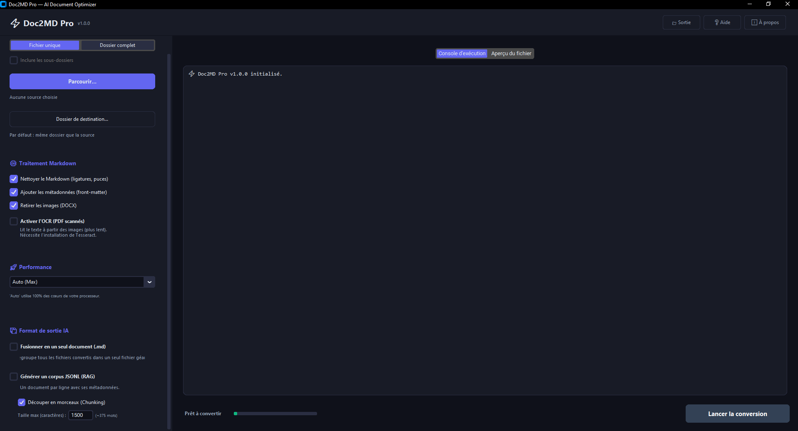

# ⚡ Doc2MD Pro — AI Document Optimizer

> Application de bureau (Windows) permettant de convertir des documents PDF, Word et Excel en Markdown structuré, optimisé pour les LLM (ChatGPT, Claude) et les bases de données vectorielles (RAG).


## 📖 À propos

La plupart des convertisseurs se contentent d'extraire le texte brut. Or, pour être exploitable par une Intelligence Artificielle (ou une base RAG comme Pinecone/Qdrant), un document doit être nettoyé, structuré et correctement découpé. 

**Doc2MD Pro** a été conçu pour répondre à ce besoin spécifique. C'est un outil local qui prend en charge les cas complexes (PDF scannés, polices corrompues) et exporte les données dans les formats attendus par les pipelines IA.

## ✨ Fonctionnalités clés

- **Haute Performance (Multiprocessing)** : Traitement en parallèle sur plusieurs cœurs de processeur. Idéal pour convertir des dossiers entiers de documents en quelques secondes.
- **OCR Intégré (Tesseract)** : Récupération de texte sur les PDF scannés ou dont l'encodage de police est défaillant.
- **Smart Chunking pour le RAG** : Découpage intelligent du Markdown en morceaux (chunks) avec chevauchement, prêts à être ingérés par une base vectorielle.
- **Nettoyage Markdown** : Suppression automatique des artefacts de conversion (numéros de page isolés, puces hétérogènes, espaces insécables).
- **100% Local** : Vos documents ne sont jamais envoyés sur un serveur externe. L'application fonctionne entièrement hors-ligne.
- **Interface Moderne** : Interface CustomTkinter en mode sombre, fluide et réactive, même pendant les longs traitements.

## 📸 Aperçu de l'interface



## 🚀 Installation

### Pour les utilisateurs (Windows)
1. Rendez-vous dans l'onglet [Releases](../../releases).
2. Téléchargez la dernière version de `Doc2MD-Pro-Windows.zip`.
3. Décompressez le dossier et lancez `main.exe`. 
*(Aucune installation de Python n'est nécessaire).*

### Pour les développeurs (Code source)
```bash
# Cloner le dépôt
git clone https://github.com/anfr/Doc2MD-Pro.git
cd Doc2MD-Pro
```
```bash
# Créer un environnement virtuel (recommandé)
python -m venv .venv
.venv\Scripts\activate
```
```bash
# Installer les dépendances
pip install -r requirements.txt
```
```bash
# Lancer l'application
python main.py
```

**Note : Pour utiliser la fonctionnalité OCR, vous devez installer Tesseract OCR sur votre système.**
## 🔄 Pipeline de traitement
L'application suit un flux de travail strict pour garantir la qualité des données :

Extraction : Utilisation de markitdown ou Tesseract pour obtenir le texte brut.

Nettoyage : Normalisation Unicode et suppression des artefacts via optimizer.py.

Enrichissement : Ajout d'un front-matter YAML (métadonnées, source, nombre de tokens).

Découpage (Optionnel) : Génération d'un fichier .jsonl où chaque ligne est un chunk contextualisé.

## 🛠️ Stack Technique
Interface : CustomTkinter (Python)

Conversion : Microsoft MarkItDown, Pandas (Excel)

OCR : PyMuPDF, Pytesseract

Architecture : Séparation des responsabilités (UI / Core / Processor) et typage strict.

## 🤝 Contribution
Les contributions sont les bienvenues. Si vous souhaitez proposer une amélioration, n'hésitez pas à ouvrir une Issue ou à soumettre une Pull Request.

## 📄 Licence
Ce projet est sous licence MIT. Voir le fichier LICENSE pour plus de détails.
